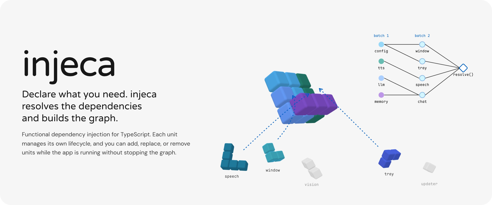
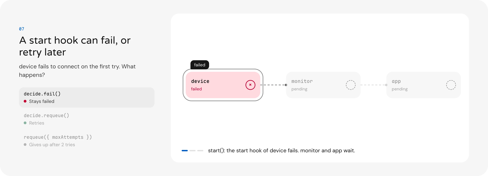
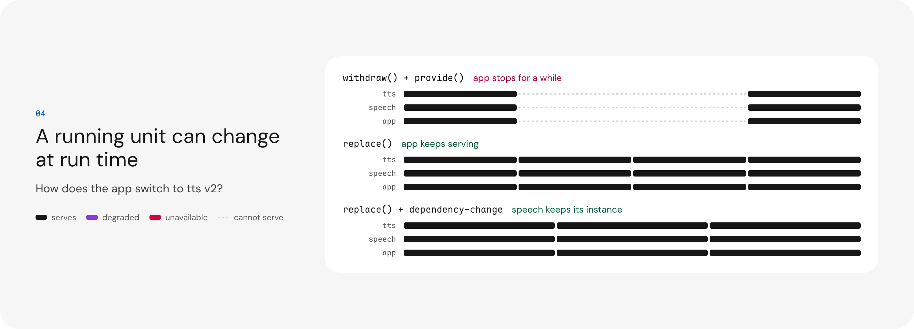
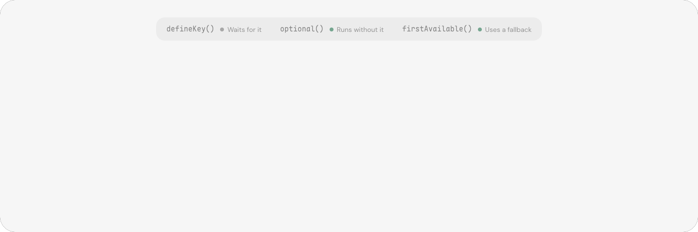
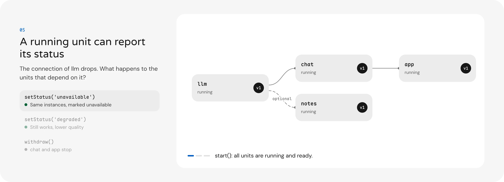
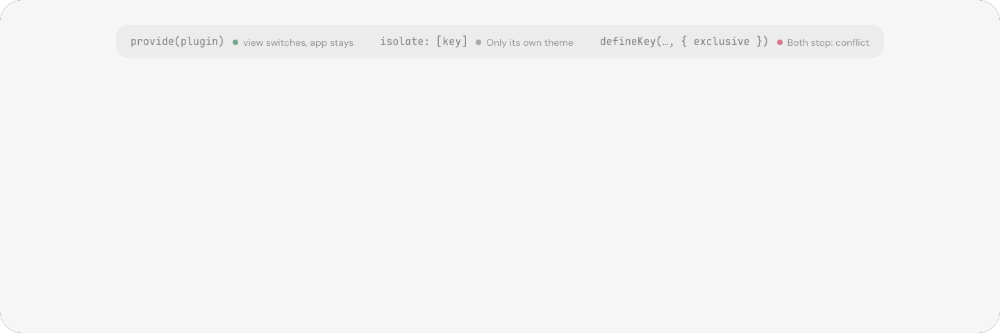
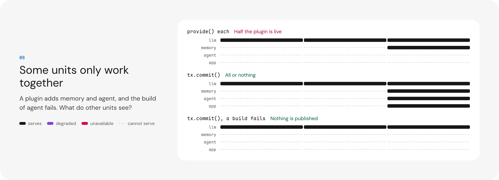

<picture>
  <source
    width="100%"
    srcset="./docs/assets/banners/hero-dark.webp"
    media="(prefers-color-scheme: dark)"
  />
  <source
    width="100%"
    srcset="./docs/assets/banners/hero-light.webp"
    media="(prefers-color-scheme: light), (prefers-color-scheme: no-preference)"
  />
  
</picture>

# injeca

[![npm version][npm-version-src]][npm-version-href]
[![npm downloads][npm-downloads-src]][npm-downloads-href]
[![bundle][bundle-src]][bundle-href]
[![JSDocs][jsdocs-src]][jsdocs-href]
[![License][license-src]][license-href]

Pure functional dependency injection for TypeScript. Units declare their dependencies, own their lifecycle, and converge when the graph changes at run time. No classes, no decorators, and no extra wrappers.

> Heavily inspired by [uber/fx](https://go.uber.org/fx), [uber/fig](https://go.uber.org/fig), and [uber/dig](https://go.uber.org/dig) in the Go ecosystem, and by the run-time model of [Cordis](https://github.com/cordiverse/cordis).

**[Open the Docs](https://injeca.moeru.ai/)** to see what each primitive does to a graph. Its Playground runs injeca in the page and steps through each scenario, so every frame shows real behavior, and lets you replace, withdraw, and set the status of units yourself, with a preview from `graph().impact()`. The Docs are in English and Simplified Chinese ([简体中文](https://injeca.moeru.ai/?lang=zh-Hans)).

<picture>
  <source
    width="100%"
    srcset="./docs/assets/banners/features-dark.webp"
    media="(prefers-color-scheme: dark)"
  />
  <source
    width="100%"
    srcset="./docs/assets/banners/features-light.webp"
    media="(prefers-color-scheme: light), (prefers-color-scheme: no-preference)"
  />
  
</picture>

## Getting started

```sh
npm install injeca
pnpm add injeca
bun add injeca
ni injeca
yarn add injeca
```

injeca works in Node.js, Electron, browsers, and workers. It has no Node-only code.

Register two units, start, and ask for one:

```ts
import { injeca } from 'injeca'

const config = injeca.provide('config', () => ({ name: 'injeca' }))

const greeter = injeca.provide('greeter', {
  dependsOn: { config },
  build: ({ dependsOn }) => {
    return (who: string) => `Hello ${who}, from ${dependsOn.config.name}`
  },
})

await injeca.start()

const { greeter: greet } = await injeca.resolve({ greeter })
console.info(greet('world')) // Hello world, from injeca

await injeca.stop()
```

- `provide` returns a typed key, and `dependsOn` takes keys. `greeter` gets `config` without an import of its value.
- `start()` builds `config` first, then `greeter`. `stop()` stops them in reverse.

Next, read [Dependency injection](#dependency-injection) for keys and the lifecycle, or open [the Playground](https://injeca.moeru.ai/) to watch each primitive work.

### Agent Skills

Install the [injeca skill](https://skills.sh) to your AI coding agent:

```sh
npx skills add moeru-ai/injeca
```

<!-- START doctoc generated TOC please keep comment here to allow auto update -->
<!-- DON'T EDIT THIS SECTION, INSTEAD RE-RUN doctoc TO UPDATE -->
## Table of Contents

- [Dependency injection](#dependency-injection)
- [Swap at run time](#swap-at-run-time)
- [Status awareness](#status-awareness)
- [Isolated containers](#isolated-containers)
- [Transactions with rollback](#transactions-with-rollback)
- [Explain](#explain)
- [Built for testing](#built-for-testing)
- [API at a glance](#api-at-a-glance)
- [Packages](#packages)
- [Migrations](#migrations)
- [Documentation automation](#documentation-automation)
- [Development](#development)
- [License](#license)

<!-- END doctoc generated TOC please keep comment here to allow auto update -->

## Dependency injection

Most programs are a set of parts that need each other: a config, a database, and a server that uses both. In injeca, each part is a unit. A unit names what it depends on, builds its value from them, and owns the hooks that start and stop it. injeca works out the order, so you write no wiring code and no teardown list.

The simplest case: two units, one that depends on the other.

```ts
import { createContainer, provide, resolve, start } from 'injeca'

const container = createContainer()

const config = provide(container, 'config', () => ({ port: 3000 }))
const server = provide(container, 'server', {
  dependsOn: { config },
  build: ({ dependsOn }) => createApp(dependsOn.config.port),
})

await start(container) // builds config, then server
const { server: app } = await resolve(container, { server })
```

<details>
<summary><strong>How do I wire units together, without classes or decorators?</strong></summary>

Register each unit with `provide()`. It returns a typed key. Another unit lists that key in `dependsOn`, and injeca builds it after its dependencies, with typed values. No unit imports the value of another.

```ts
import { createServer } from 'node:http'

import { createContainer, invoke, provide, resolve, start, stop } from 'injeca'

const container = createContainer()

// A unit is a name and a build function. provide() returns a typed key.
const config = provide(container, 'config', () => ({ port: 3000 }))

// dependsOn takes keys. injeca infers the type of dependsOn.config from the key.
const server = provide(container, 'server', {
  dependsOn: { config },
  build: ({ dependsOn, on }) => {
    const app = createServer()

    // The hooks run with the unit. See "How do I start and stop resources in the right order?"
    on('start', () => app.listen(dependsOn.config.port))
    on('stop', () => app.close())

    return app
  },
})

// invoke() runs a callback when its dependencies run. It has no value of its own.
invoke(container, {
  dependsOn: { server },
  callback: ({ server }) => console.info('HTTP server ready:', server.address()),
})

// start() builds config, then server, then runs the callback.
// It resolves when everything is running.
await start(container)

// resolve() gives the values of the keys that you ask for.
const { config: settings } = await resolve(container, { config })
console.info(settings.port) // 3000

process.once('SIGINT', async () => {
  // stop() stops server before config. The registrations stay,
  // so a later start() builds them again.
  await stop(container)
})
```

- The examples in this guide use a container that you create with `createContainer()`. The global container does the same with `injeca.provide`, `injeca.invoke`, `injeca.resolve`, `injeca.start`, and `injeca.stop`, as in [Getting started](#getting-started). `injeca.getContainer()` returns it.
- `provide(container, name, build)` is the short form for a unit without dependencies. `provide(container, { dependsOn, build })` without a name also works.
- `resolve()` waits for a missing provider. Before `start()`, it builds the units that it needs, with their `start` hooks.
- `invoke()` returns a handle with `key` and `withdraw()`. Graph queries accept `key`. The callback runs again when a required dependency gets a new instance.
- injeca writes no lifecycle logs by default. It writes warnings with `console.warn`. See [Turn on logging](#explain).

> [!WARNING]
>
> **`injeca` caches each value that `build` returns.**
>
> `build` runs once for each instance. If `build` returns a function, injeca caches that function, not the result of a call. This is useful for lazy dependencies and getters. Side effects inside the returned function run on every call.
>
> To reuse one resource, for example a single window, create it once inside `build` and return a wrapper:
>
> ```ts
> const settingsWindow = provide(container, 'windows:settings', {
>   dependsOn: { widgetsManager },
>   build: ({ dependsOn }) => {
>     const getWindow = setupReusableSettingsWindow(dependsOn) // created once
>     return async () => await getWindow() // can be called many times
>   },
> })
> ```

</details>

<details>
<summary><strong>How does a unit move from build to stop?</strong></summary>

<picture>
  <source
    width="100%"
    srcset="./docs/assets/banners/phases-dark.webp"
    media="(prefers-color-scheme: dark)"
  />
  <source
    width="100%"
    srcset="./docs/assets/banners/phases-light.webp"
    media="(prefers-color-scheme: light), (prefers-color-scheme: no-preference)"
  />
  
</picture>

Each unit has a phase. A unit runs no code until its required dependencies run.

| Phase | Meaning |
| --- | --- |
| `declared` | A [transaction](#transactions-with-rollback) reserved the unit. Consumers cannot resolve it. |
| `pending` | The unit waits for its required dependencies. It runs no code. |
| `conflict` | An [exclusive key](#isolated-containers) has more than one provider. It runs no code. |
| `building` | `build` runs. The instance is not visible. |
| `starting` | The instance is published. The `start` hooks run. |
| `retrying` | A `start` hook returned `requeue`. The unit waits for the next attempt. |
| `running` | The instance serves calls. Only this phase has a [status](#status-awareness). |
| `stopping` | The unit waits until its dependents release it. Then the `stop` hooks and the effect disposers run. |
| `failed` | A build failed, the retries ended, or a hook returned `fail`. |
| `withdrawn` | The registration is withdrawn and the instance is disposed. |

</details>

<details>
<summary><strong>How do I start and stop resources in the right order?</strong></summary>

Register `start` and `stop` hooks inside `build`. A `start` hook runs after the unit's dependencies run. A `stop` hook runs before they stop, so each hook can still use them.

```ts
import { createContainer, provide, start, stop } from 'injeca'

const container = createContainer()

const config = provide(container, 'config', () => ({ url: 'sqlite://memory.db' }))

const memory = provide(container, 'memory', {
  dependsOn: { config },
  build: ({ dependsOn, on, effect }) => {
    const db = createDatabase(dependsOn.config.url)

    // Runs after memory is published and config runs.
    on('start', async ({ decide }) => {
      try {
        await db.connect()
      }
      catch (error) {
        // memory goes to `failed`, and units that require it wait.
        return decide.fail(error)
      }
    })

    // Runs before memory stops. config is still available here.
    on('stop', () => db.close())

    // effect() runs its setup now. The disposer runs after the stop hooks.
    effect(() => {
      const timer = setInterval(() => db.vacuum(), 60_000)
      return () => clearInterval(timer)
    })

    return db
  },
})

provide(container, 'agent', {
  dependsOn: { memory },
  build: ({ dependsOn, on }) => {
    const agent = createAgent(dependsOn.memory)

    on('start', () => agent.resume())
    // agent stops before memory, so it can still save to it.
    on('stop', () => agent.save())

    return agent
  },
})

// config, then memory (build, start), then agent (build, start).
// start() rejects with the build and start errors.
await start(container)

// The reverse order: agent, then memory, then config.
await stop(container)
```

The build context has these fields:

| Field | Meaning |
| --- | --- |
| `dependsOn` | The resolved dependencies |
| `on('start', handler)` | Runs after the unit is published and its dependencies run |
| `on('stop', handler)` | Runs before the unit stops. Its dependencies are still available. |
| `effect(setup)` | Runs `setup` at once. The disposer that it returns runs when the instance is disposed, after the `stop` hooks. |
| `signal` | An `AbortSignal` that aborts when a newer target replaces this build, or when the container is disposed |
| `setStatus(status, reason?)` | Sets the status of the instance. See [Know when a dependency is degraded or down](#status-awareness). |

- A hook gets a hook context with a typed `decide`, `attempt`, `previous`, and `signal`. Return a decision to tell injeca what to do next.
- A return value that is not a decision, for example the result of `app.listen()`, selects the default of the hook.
- A `start` hook accepts `handled`, `requeue`, `stop`, and `fail`. A `stop` hook accepts `handled` and `fail`. Another decision is a type error.
- `on()` is valid only while `build` runs. A later call throws `HookOutsideBuildError` (`hook-outside-build`).

</details>

<details>
<summary><strong>Can I call dispose from a cleanup?</strong></summary>

Pass the `signal` of the cleanup to the call, so that injeca knows the caller. Then the call resolves at once, and the teardown continues. Without the signal, the call can wait for itself. A cleanup that awaits `stop()` or `dispose()` of its own container, or of an ancestor, waits for itself. A cleanup that awaits `withdraw()` of its own registration, or of a provider that it holds, waits for itself too. So does a cleanup that awaits `stop()` or `dispose()` of a container whose unit it holds.

```ts
import { createContainer, dispose, provide } from 'injeca'

const plugin = createContainer({ owner: { kind: 'plugin', id: 'window' } })

provide(plugin, 'plugin:window', ({ on }) => {
  const window = createWindow()

  on('stop', async ({ signal }) => {
    await window.close()
    // The disposal of plugin waits for this hook, so this call cannot wait for it.
    // With the signal, injeca sees that and resolves at once. The disposal continues.
    await dispose(plugin, { signal })
  })

  return window
})
```

- injeca knows the instance of each signal that it gives to a build, a hook, and an invocation. A signal from `withTimeout(signal, ms, container)` keeps that origin. A signal from `AbortSignal.any()` does not.
- A call with such a signal while the teardown of its instance runs does not wait. The check uses the instance, so it also works during a rebuild or a replacement, when the old and the new instance live together. A signal of the new running instance still waits.
- The cleanup can also be outside the container. A unit of the parent that holds a parent-visible unit of a plugin container, directly or through other units, stops before that unit. So its `stop` hook can call `dispose(plugin, { signal })` or `stop(plugin, { signal })`, and the call does not wait. A plugin host that stops a plugin from its own cleanup needs this.
- The same works for `withdraw()`. For example, `await sharedTool.withdraw({ signal })` in a `stop` hook waits for the parent-visible unit, or resolves at once when it is re-entrant.
- A call from the synchronous part of a cleanup does not wait either.
- Such a call writes a warning with `logger.warn`, sends a `reentrant-call` record to `observe`, and resolves at once. A re-entrant `withdraw()` resolves `true`. The stop, the disposal, or the withdrawal continues. Other callers get a promise that settles when it ends.
- A call without a signal after an `await` is not found. It waits for itself until a configured `stop` timeout ends the cleanup. The warning of that timeout tells about this cause.

</details>

<details>
<summary><strong>How do I retry a start that fails, with a limit?</strong></summary>

Return `decide.requeue()` from a `start` hook. The unit keeps its instance, so `build` does not run again. injeca runs the hook again after the delay that you set, until `maxAttempts` ends the retries.

```ts
import { createContainer, provide, start } from 'injeca'

// The limit for each unit in this container and its children.
const container = createContainer({ maxAttempts: 10 })

provide(container, 'llm', {
  // A unit value wins over the container value.
  maxAttempts: 3,
  build: ({ on }) => {
    const llm = createLlmClient()

    on('start', async ({ decide, attempt }) => {
      try {
        await llm.connect()
      }
      catch (error) {
        // llm goes to `retrying`. It keeps its instance and its dependencies,
        // but it is not available, so units that require it stay `pending`.
        return decide.requeue({
          // 500 ms, then 1 s, 2 s, and so on, up to 30 s. jitter takes up to 20% away.
          backoff: { kind: 'exponential', initial: 500, max: 30_000, jitter: 0.2 },
          // A value on the decision wins over the unit and the container.
          maxAttempts: 5,
          reason: `connect failed on attempt ${attempt}: ${String(error)}`,
        })
      }
    })

    return llm
  },
})

// Resolves when llm runs. When the attempts end, llm goes to `failed`,
// and start() rejects with the error.
await start(container)
```

<picture>
  <source
    width="100%"
    srcset="./docs/assets/banners/compare-retry-dark.webp"
    media="(prefers-color-scheme: dark)"
  />
  <source
    width="100%"
    srcset="./docs/assets/banners/compare-retry-light.webp"
    media="(prefers-color-scheme: light), (prefers-color-scheme: no-preference)"
  />
  
</picture>

- `after: ms` sets a fixed delay. `backoff` doubles `initial` for each attempt, up to `max`. `jitter` is a fraction from 0 to 1 that takes a random part away from each delay.
- `createContainer({ random })` sets the random source of the jitter, for example `() => 0.5` for deterministic tests.
- The next attempt runs the `start` handler that requeued, then the handlers after it.
- Changes during the wait merge into one attempt. A withdrawn required dependency, or `stop()`, cancels the wait and stops the unit at once.
- A dependency hook can requeue too. The unit stays `running` with its current dependencies during the wait.
- injeca has no built-in delay or limit. Without `maxAttempts`, the retries continue.
- `maxAttempts` limits the runs of one hook for one instance. The decision wins over the unit, and the unit wins over the container. A child container uses the value of its nearest ancestor.
- When the attempts end, a running unit stops first. Then it goes to `failed` with the last reason. `start()` again, `stop()` and `start()`, or `replace()` moves it out of `failed`.

[Try it in the Playground →][lab-retry]

</details>

<details>
<summary><strong>How do I limit how long a hook runs?</strong></summary>

Set `timeouts` on the container or on the unit, and `onTimeout` to decide what happens then. Without them, `start` and `stop` hooks wait until they settle. injeca has no built-in timeout.

```ts
import { createContainer, provide } from 'injeca'

// Each stop of each unit in this container may take 5 s.
const container = createContainer({ timeouts: { stop: 5_000 } })

provide(container, 'tts', {
  // A unit value overrides the container value.
  timeouts: { start: 10_000 },
  // Runs synchronously. context.decide has the methods of the hook that timed out.
  onTimeout: (context) => {
    if (context.hook === 'start')
      return context.decide.requeue({ after: 1_000, maxAttempts: 3 })
    return undefined // a stop timeout counts as handled
  },
  build: () => createTts({ model: 'v1' }),
})
```

- The `start` timeout is for all `start` handlers of one attempt. The `stop` timeout is for all `stop` handlers and effect disposers of one instance.
- When a timeout passes, `observe` gets a `timeout` record. Then `onTimeout` of the unit, or of the container, decides.
- Without `onTimeout`, a `start` timeout gives `fail` with a `HookTimeoutError` (`hook-timeout`).
- Without `onTimeout`, a `stop` timeout counts as `handled`. injeca writes a warning with `logger.warn`, and `stop()`, `dispose()`, and `withdraw()` resolve as usual. Only `decide.fail()` from `onTimeout` fails them.
- During a stop or a disposal of the container, the warning tells that a cleanup can be waiting for its own container. Then that cleanup must pass its signal. See [Call dispose from a cleanup](#dependency-injection).
- After a `stop` timeout, the remaining cleanups still run, but injeca does not wait for them. So a cleanup that awaits the disposal of its own container without its signal cannot block that disposal.
- A cleanup or a `start` hook that injeca stopped waiting for can still fail later. injeca writes that failure with `logger.warn`, and a late `stop` decision gets a `decision` record with `ignored: true`. A rejection with the abort reason of the callback signal has no warning, because the callback only followed its abort.
- `stop()` and `dispose()` abort the signal of a `start` hook in progress and do not wait for it. The `stop` hooks run at once. A decision that the hook returns later is ignored.
- At a `start` timeout, the `signal` of the hook aborts with the `HookTimeoutError`. A `stop` handler sees the `stop` timeout on its `signal` in the same way.
- The `stop` timeout of a container also covers its container effects at its disposal, all of them together. A child container without a value uses the value of its nearest ancestor. At the timeout, injeca warns, `observe` gets a `timeout` record with `key: ''`, and the disposal continues and resolves. `onTimeout` does not run for it. A container effect has no signal, so it must not await `stop()` or `dispose()` of its own container. Before 0.5.2, such an effect blocked the disposal forever.

</details>

<details>
<summary><strong>How do I stop waiting after a time limit?</strong></summary>

Pass `{ signal }`, a standard `AbortSignal`, to the call. Each call that can wait takes one. `timeout(container, ms)` makes a signal on the container clock. injeca has no built-in timeout for these calls.

```ts
import { createContainer, provide, resolve, start, StartTimeoutError, stop, timeout, withTimeout } from 'injeca'

const container = createContainer()
const llm = provide(container, 'llm', () => createLlmClient())

try {
  // A missing provider or a dependency cycle keeps start() waiting. The signal ends the wait.
  await start(container, { signal: timeout(container, 10_000) })
}
catch (error) {
  // StartTimeoutError explains each unit that is not running.
  if (error instanceof StartTimeoutError)
    console.error(error.explanations)
  throw error
}

// In a request handler: give up when the client goes away, or after 5 s.
// On a timeout, resolve() rejects with WaitTimeoutError.
export async function handle(request: Request) {
  const { llm: client } = await resolve(container, { llm }, { signal: withTimeout(request.signal, 5_000, container) })
  return client.chat(await request.text())
}

// stop() rejects with the reason after 5 s. The container is still stopped.
await stop(container, { signal: timeout(container, 5_000) })
```

- `timeout(container, ms)` aborts after `ms` on the clock of the container, with a `DOMException` named `TimeoutError`. Tests with a [manual clock](#built-for-testing) control it. `AbortSignal.timeout()` does not use the container clock.
- `withTimeout(signal, ms, container)` aborts when `signal` aborts, or after `ms`. `signal` can be `undefined`.
- An aborted signal ends the call at once. A call removes its listener from the signal when it settles.
- A timeout reason is a reason with `name === 'TimeoutError'`, from `timeout()` or from `AbortSignal.timeout()`.
- For `start`, `stop`, `dispose`, and `withdraw`, an aborted signal still starts the action. Only the wait ends.
- For `stop`, `dispose`, and `withdraw`, each unit that did not stop gets a `wait-aborted` record in `observe`, with the phase at the abort and the reason.
- `replace` and `tx.commit` send no `wait-aborted` record. Their abort cancels the work, so no work continues without a waiter. The new instance leaves with its usual phase records.
- `resolve`, `waitFor`, `start`, and `replace` turn a timeout reason into a typed error, because they wait for a state. The error tells which state did not come.

| Call | When the signal aborts |
| --- | --- |
| `resolve(container, deps, { signal })` | Rejects. A timeout reason gives `WaitTimeoutError` (`wait-timeout`) with the reason as `cause`. Another reason rejects as it is. The hidden resolver goes. |
| `waitFor(container, key, { status, signal })` | The same as `resolve`. |
| `start(container, { signal })` | Stops the wait only. The units keep converging. A timeout reason gives `StartTimeoutError` (`start-timeout`) with the explanations. Another reason rejects as it is. |
| `stop(container, { signal })` | Rejects with the reason. The container is stopped, and a later `start()` builds again. The units that did not stop stay in `stopping` until their cleanups settle. |
| `dispose(container, { signal })` | Rejects with the reason. The disposal continues in the background, and the container stays in `disposing`. A later `dispose(container)` waits for the same disposal and gets its result. |
| `registration.withdraw({ signal })` | Rejects with the reason. The withdrawal continues. The unit gets a `wait-aborted` record when it did not finish. `invoke()` handles take the same option. |
| `registration.replace(option, { signal })` | Cancels a pending replacement, as a newer `replace()` does. The old instance stays, and `replace()` rejects. A timeout reason gives `WaitTimeoutError` (`wait-timeout`). Its message tells what the new instance waits for. Another reason rejects as it is. An aborted signal rejects at once and changes nothing. After the swap, the abort has no effect. A required dependency of the new instance that fails before the swap also cancels it, with or without a signal. Then `replace()` rejects with that failure, as `resolve()` does. |
| `tx.commit({ signal })` | Before the publish, the transaction aborts and rolls back, and `commit()` rejects at once with the reason. A `tx.replace` keeps the old instance. After the publish, the abort has no effect. The commit does not wait for the swap of a `tx.replace`. |

</details>

## Swap at run time

An app that loads plugins, or reloads its code, changes its graph while it runs. injeca treats this as the normal case, not as an exception. You can add, withdraw, or replace a unit at any time, and the units that depend on it converge to the new graph without a gap.

<picture>
  <source
    width="100%"
    srcset="./docs/assets/banners/compare-swap-dark.webp"
    media="(prefers-color-scheme: dark)"
  />
  <source
    width="100%"
    srcset="./docs/assets/banners/compare-swap-light.webp"
    media="(prefers-color-scheme: light), (prefers-color-scheme: no-preference)"
  />
  
</picture>

The simplest case: replace a running unit with a new build.

```ts
import { createContainer, provide, start } from 'injeca'

const container = createContainer()
const tts = provide(container, 'tts', () => createTts({ model: 'v1' }))

await start(container)

// v2 builds and starts while v1 serves. Then v2 takes its place, and v1 stops.
await tts.replace(() => createTts({ model: 'v2' }))
```

<details>
<summary><strong>How do I swap a dependency while the app runs?</strong></summary>

Use `replace()`. It builds the new instance next to the old one and switches only when the new one runs. Nothing that depends on it stops, and a failed build changes nothing.

```ts
import { createContainer, provide, start } from 'injeca'

const container = createContainer()

// provide() returns a handle. Keep it: you change the unit through it later.
const tts = provide(container, 'tts', () => createTts({ model: 'v1' }))

provide(container, 'speech', {
  dependsOn: { tts },
  // speech builds with tts v1. When tts gets a new instance, injeca builds a
  // new speech with it and swaps it in the same way, so the units that use
  // speech never stop.
  build: ({ dependsOn }) => createSpeech(dependsOn.tts),
})

await start(container)

// Later, for example on a hot reload:
// - tts v2 runs `build` and `start` while v1 keeps serving speech.
// - Then one batch swaps them, and v1 stops once nothing uses it.
// - If v2 fails to build or start, replace() rejects and v1 stays.
await tts.replace(() => createTts({ model: 'v2' }))
```

Do you want speech to keep its instance and only take the new tts? Handle the change in place:

```ts
import { createContainer, provide } from 'injeca'

const container = createContainer()
const tts = provide(container, 'tts', () => createTts({ model: 'v1' }))

provide(container, 'speech', {
  dependsOn: { tts },
  build: ({ dependsOn, on }) => {
    const speech = createSpeech(dependsOn.tts)

    // Without this handler, speech rebuilds. With it, speech decides.
    on('dependency-change', ({ dependsOn, decide }) => {
      // dependsOn is the current snapshot of all dependencies, with each value.
      speech.setTts(dependsOn.tts.value)
      // handled: keep this instance. Return nothing, and speech rebuilds.
      return decide.handled()
    })

    return speech
  },
})
```
- A withdrawal followed by a new `provide` leaves a gap: all dependents stop. `replace()` has no gap. A hot reload tool uses it.
- The swap is one batch. It occurs only after the new instance completes `start`. The new instance is `ready`.
- For a per-container registration, each running consumer gets a new instance first. The swap of all consumers is one batch, after each new instance completes `start`. If one fails, no consumer changes.
- If the new `build` or `start` fails, `replace()` rejects and the old instance does not change. A replacement is also the usual fix for an `unavailable` provider.
- If a required dependency of the new instance fails before the swap, `replace()` cancels the replacement and rejects at once. The error is the failure of that dependency, the same error that `resolve()` gives. This also applies to a dependency that failed before the call, and to a failure through a pending provider. The old instance does not change.
- A failed optional dependency, or a failed `firstAvailable` alternative while another one is available, does not reject. A per-container replacement rejects when a required dependency of the new instance of any consumer unit fails.
- `tx.commit()` does not wait for the swap of a `tx.replace`. So a failed dependency does not reject the commit. The new instance waits in `pending`, and the old instance stays.
- `replace()` takes the short form or the object form, with or without `dependsOn`. An option without `metadata`, `maxAttempts`, `timeouts`, or `onTimeout` keeps that value of the registration. `instances` and `visibility` do not change.
- The old instance stops after each dependent releases it. A dependent with a `dependency-change` handler moves in place. Other dependents rebuild without a gap, so a replacement deep in the graph does not stop the units above it.
- `graph(container).explain(key)` shows the new instance as `replacement` while the swap waits, with its phase and blockers.
- A stale registration, or a call that a newer `replace()` or a withdrawal supersedes, resolves `false`. A unit in `stopping` rejects with `ReplaceWhileStoppingError`.
- `replace(option, { signal })` cancels the pending replacement when the signal aborts, and rejects. A newer `replace()` still resolves `false`, so a caller can tell a timeout from a supersede. See [Stop waiting after a time limit](#dependency-injection).

```ts
try {
  await extension.replace({ dependsOn: { gateway: gatewayKey }, build: createExtension }, { signal: timeout(container, 5_000) })
}
catch (error) {
  if (error instanceof WaitTimeoutError)
    // replace('extension') timed out before the swap. The replacement is not running:
    // - extension is pending: no provider for 'airi.gateway' (gateway)
    report(error.message)
  else
    throw error
}
```

- The message of the `WaitTimeoutError` explains the new instance at the timeout. For a per-container registration, it has one line for each consumer unit that did not complete `start`. The replacement is gone after the abort, so `graph(container).explain()` no longer shows it.

[Try it in the Playground →][lab-swap] · [Try the handler →][lab-handler]

</details>

<details>
<summary><strong>How do I add and remove units after start?</strong></summary>

Call `provide()` or `withdraw()` at any time. Units can appear and disappear after `start()`, and dependents converge automatically.

```ts
import { createContainer, provide, start } from 'injeca'

const container = createContainer()
const config = provide(container, 'config', () => ({ camera: 0 }))

await start(container)

// A provide after start() builds and starts when its dependencies run.
const vision = provide(container, 'vision', {
  dependsOn: { config },
  build: ({ dependsOn }) => createVision(dependsOn.config),
})

// Dependents of vision stop first, then vision.
// A stale registration resolves false and changes nothing.
await vision.withdraw()
```

When a dependency changes, a dependent does this:

| Change | No handler | With a `dependency-change` handler |
| --- | --- | --- |
| A required dependency is replaced | Rebuild without a gap | Call the handler |
| A required dependency is withdrawn | Stop | Stop. The handler gets a notice only. |
| An optional dependency appears, goes, or is replaced | Rebuild | Call the handler |
| The status of a dependency changes | Nothing | `dependency-status-change` gets a call, if it has a handler |

A rebuild of a running unit has no gap. The old instance keeps serving while a new instance builds and starts against the new dependencies. Then one batch swaps them, as for `replace()`. The dependents of the unit get `dependency-change` with the new instance. They do not lose it.

- This applies to a rebuild without a handler and to `decide.rebuild()`.
- The unit stops first and builds again when a dependency that the old instance uses has no provider now. Then there is nothing to build against.
- An invocation stops first and runs again.
- If the new instance fails, the old instance stops and the unit goes to `failed`.
- A `replace()` during the rebuild cancels the rebuild and replaces the unit.

</details>

<details>
<summary><strong>How do I depend on something a plugin provides later?</strong></summary>

Depend on a key from `defineKey()`. It is a typed key without a provider, and a unit can depend on it now. The unit stays `pending` and runs no code until a provider registers. `optional()` and `firstAvailable()` let it run without one, or fall back to another provider.

```ts
import { createContainer, defineKey, firstAvailable, optional, provide, start } from 'injeca'

// Export the keys from a shared module. Plugins import the key, not the host.
export const llmKey = defineKey<LlmClient>('airi.llm')
export const remoteLlmKey = defineKey<LlmClient>('airi.llm.remote')
export const ttsKey = defineKey<Tts>('airi.tts')

const container = createContainer()

provide(container, 'speech', {
  dependsOn: {
    // Required, with a fallback: the first candidate that runs and is available.
    llm: firstAvailable(remoteLlmKey, llmKey),
    // Optional: `{ value, status }`, or `undefined` without a provider.
    tts: optional(ttsKey),
  },
  build: ({ dependsOn }) => createSpeech(dependsOn.llm, dependsOn.tts?.value),
})

// speech waits in `pending`, because no candidate of llm has a provider yet.
// So start() stays pending too.
const started = start(container)

// A plugin provides one later. The build result must match LlmClient.
// speech builds now. When a remote llm runs later, speech moves to it.
provide(container, llmKey, () => createLocalLlm())
await started
```

<picture>
  <source
    width="100%"
    srcset="./docs/assets/banners/compare-late-dark.webp"
    media="(prefers-color-scheme: dark)"
  />
  <source
    width="100%"
    srcset="./docs/assets/banners/compare-late-light.webp"
    media="(prefers-color-scheme: light), (prefers-color-scheme: no-preference)"
  />
  
</picture>

- A plain key is required. The dependent waits for it.
- `optional(key)` gives `{ value, status }`, or `undefined` without a provider. The dependent builds at once, and rebuilds when the provider appears or goes.
- `firstAvailable(...keys)` selects the first candidate that runs and is available. When a candidate earlier in the list starts to run, the dependent moves to it.
- `optional(firstAvailable(...))` works too. It gives `undefined` when no candidate runs.

[Try it in the Playground →][lab-late]

</details>

<details>
<summary><strong>How do I accept only some providers?</strong></summary>

Wrap the key in `where(key, condition)`. injeca accepts a provider only when the condition returns `true`. The condition reads the `key`, the `owner`, and the `metadata` of the provider.

```ts
import type { ProviderInfo } from 'injeca'

import { createContainer, defineKey, firstAvailable, optional, provide, where } from 'injeca'

const container = createContainer({ owner: { kind: 'host' } })

// metadata is a frozen record on any registration. Conditions and graph queries read it.
const panelKey = provide(container, 'whiteboard:panel', { metadata: { version: '2.1.0' }, build: () => createPanel() })
const themeKey = defineKey<Theme>('ui:theme')
const remoteLlmKey = defineKey<LlmClient>('airi.llm.remote')
const localLlmKey = defineKey<LlmClient>('airi.llm.local')

const atLeastTwo = ({ metadata }: ProviderInfo) => String(metadata.version).startsWith('2.')

provide(container, 'whiteboard:view', {
  dependsOn: {
    // Required: a rejected provider keeps the view `pending`.
    panel: where(panelKey, atLeastTwo),
    // Optional: a rejected provider gives `undefined`.
    theme: optional(where(themeKey, ({ owner }) => owner.kind === 'host')),
    // The condition applies to each candidate.
    llm: where(firstAvailable(remoteLlmKey, localLlmKey), atLeastTwo),
    // The condition applies to the remote candidate only.
    backup: optional(firstAvailable(where(remoteLlmKey, atLeastTwo), localLlmKey)),
  },
  build: ({ dependsOn }) => createView(dependsOn.panel, dependsOn.theme?.value, dependsOn.llm, dependsOn.backup?.value),
})
```

- The condition must be pure and synchronous. A thrown error counts as `false` and goes to the observe stream.
- A condition also filters the candidates of `firstAvailable`. The selection is the first available candidate that passes.
- `where`, `firstAvailable`, and `optional` combine in any order. A candidate with two conditions must pass both.
- `graph(container).explain()` names each candidate that a condition rejected.

</details>

## Status awareness

A dependency is not only present or gone. A model API can be rate limited, and a socket can be reconnecting, while the instance still exists. injeca lets a running unit report this with a status. It carries the status down to each unit that requires it, and it stops or rebuilds nothing.

<picture>
  <source
    width="100%"
    srcset="./docs/assets/banners/compare-status-dark.webp"
    media="(prefers-color-scheme: dark)"
  />
  <source
    width="100%"
    srcset="./docs/assets/banners/compare-status-light.webp"
    media="(prefers-color-scheme: light), (prefers-color-scheme: no-preference)"
  />
  
</picture>

The simplest case: a unit reports its status, and a caller waits until it is ready.

```ts
import { createContainer, provide, start, waitFor } from 'injeca'

const container = createContainer()

const llm = provide(container, 'llm', ({ setStatus }) => {
  const client = connectLlm()
  client.on('offline', () => setStatus('unavailable', 'offline'))
  client.on('online', () => setStatus('ready'))
  return client
})

await start(container)

// Resolves when llm runs with the status ready.
await waitFor(container, llm, { status: 'ready' })
```

<details>
<summary><strong>How do I know when a dependency is degraded or down?</strong></summary>

Let the unit report a status. A running unit calls `setStatus()` with `ready`, `degraded`, or `unavailable`. The status goes down the graph to each unit that requires it. No unit stops or rebuilds, and each unit keeps its instance.

```ts
import { createContainer, optional, provide, start, timeout, waitFor, watch } from 'injeca'

const container = createContainer()

const llm = provide(container, 'llm', ({ setStatus }) => {
  const client = connectLlm()

  // A reconnect passes, so report it with a status. Do not withdraw the unit.
  client.on('reconnecting', () => setStatus('unavailable', { reason: 'reconnecting' }))
  client.on('rate-limited', () => setStatus('degraded', 'rate limited'))
  client.on('ready', () => setStatus('ready'))

  return client
})

// chat requires llm. Its effective status is the worst of its own status and that of llm.
const chat = provide(container, 'chat', {
  dependsOn: { llm },
  build: ({ dependsOn, on }) => {
    const chat = createChat(dependsOn.llm)

    // Optional. Without this handler, a status change does nothing to chat.
    on('dependency-status-change', ({ dependsOn }) => {
      chat.setOffline(dependsOn.llm.status === 'unavailable')
    })

    return chat
  },
})

// notes uses llm as optional, so the status of llm does not change the status of notes.
provide(container, 'notes', {
  dependsOn: { llm: optional(llm) },
  build: ({ dependsOn }) => createNotes(dependsOn.llm?.value),
})

await start(container)

// watch() sends the current state at once, then each change, in order.
const stopWatching = watch(container, chat, ({ phase, status, reason }) => {
  console.info('chat', phase, status, reason)
})

// waitFor() waits for a status. The signal ends the wait with WaitTimeoutError.
await waitFor(container, chat, { status: 'ready', signal: timeout(container, 5_000) })
stopWatching()
```
- `degraded` means that calls still complete, at lower quality.
- `unavailable` means that the instance exists, but calls fail now.
- Only a `running` unit has a status. The effective status of a unit is the worst of its own status and the effective status of each required dependency.
- An optional dependency does not change the effective status.
- A dependency that becomes `unavailable` does not stop or rebuild its dependents. They get a `dependency-status-change` call if they register a handler.
- Use a status for a condition that passes, such as a reconnect. Withdraw a unit only when it is gone for good.
- `setStatus(status, { reason, cause })` also takes a `cause`, so that a remote plugin can report a cause inside the plugin. `setStatus` stays valid after `build` returns.
- `waitFor` rejects with a `UnitFailedError` (`unit-failed`) when the unit failed, or waits for a required provider that failed. Its `cause` is the failure.
- For a per-container key, `watch` and `waitFor` create the consumer instance for their container, as `resolve` does. The demand ends with the subscription.

[Try it in the Playground →][lab-status]

</details>

<details>
<summary><strong>How do I read state without waiting?</strong></summary>

Use `peek`. It reads a value now, without a wait, and never builds anything. `observe` sends each event of the container and its children.

```ts
import { observe, peek, where } from 'injeca'

const result = peek(host, where(llmKey, ({ metadata }) => metadata.version === '2'))
if (result.kind === 'resolved')
  result.value.chat('hello')
else
  console.info(result.kind) // 'missing', 'rejected', 'conflict', 'not-running', or 'unavailable'

const stopObserving = observe(host, (record) => {
  // A phase change, status change, decision, hook timeout, aborted wait, or re-entrant call.
  console.info(record.type)
})
stopObserving()
```

- `observe` sends each phase change, status change, decision, hook timeout, aborted wait, and re-entrant call in the container and its children.
- To follow one unit, or to wait for it, use `watch` and `waitFor`. See [Know when a dependency is degraded or down](#status-awareness).

</details>

## Isolated containers

A plugin uses what the host gives, adds its own units, and must leave cleanly. injeca gives each plugin a child container for this. The child sees the units of its ancestors and keeps its own units local, unless it shares them. One `dispose()` removes everything that the plugin brought.

<picture>
  <source
    width="100%"
    srcset="./docs/assets/banners/compare-containers-dark.webp"
    media="(prefers-color-scheme: dark)"
  />
  <source
    width="100%"
    srcset="./docs/assets/banners/compare-containers-light.webp"
    media="(prefers-color-scheme: light), (prefers-color-scheme: no-preference)"
  />
  
</picture>

The simplest case: a child container uses a unit of the host, and one call removes it.

```ts
import { createContainer, dispose, provide, start } from 'injeca'

const host = createContainer()
const llm = provide(host, 'llm', () => createLlmClient())
await start(host)

const plugin = createContainer({ parent: host })
// The plugin resolves llm from the host.
provide(plugin, 'plugin:chat', { dependsOn: { llm }, build: ({ dependsOn }) => createChat(dependsOn.llm) })
await start(plugin)

// Stops and withdraws all units of the plugin. The host keeps running.
await dispose(plugin)
```

<details>
<summary><strong>How do I give each plugin its own container?</strong></summary>

Create a child container with `createContainer({ parent })`. A child container resolves keys from its ancestors, so a plugin uses the units of the host. `dispose()` removes everything that the plugin registered, at once.

```ts
import { createContainer, defineKey, dispose, effect, provide, start, timeout } from 'injeca'

const themeKey = defineKey<Theme>('ui:theme')
const llmKey = defineKey<LlmClient>('airi.llm')

// owner is a serializable record. Graph queries and conditions read it.
const host = createContainer({ owner: { kind: 'host' } })
provide(host, themeKey, () => createTheme('light'))
provide(host, llmKey, () => createLlmClient())
await start(host)

const plugin = createContainer({
  parent: host,
  owner: { kind: 'plugin', id: 'agent-activity' },
})

// llm resolves from the host.
provide(plugin, 'agent-activity:reaction', {
  dependsOn: { llm: llmKey, theme: themeKey },
  build: ({ dependsOn }) => createReaction(dependsOn.llm, dependsOn.theme),
})

// The plugin brings its own theme. It shadows the host theme only while it runs,
// so the reaction uses the host theme until then.
provide(plugin, themeKey, () => createTheme('dark'))

// A container effect. Its disposer runs when the container is disposed.
effect(plugin, () => () => console.info('plugin cleaned up'))

// A child does not start with its parent, so you can register all its units first.
// The signal makes start() reject with StartTimeoutError, which explains each unit that is not running.
await start(plugin, { signal: timeout(plugin, 10_000) })

// Stops the units, withdraws the registrations, and runs the effects.
// A disposed container cannot be used again.
await dispose(plugin)
```
- Create containers also to keep tests apart.
- `stop()` stops. `dispose()` also withdraws the registrations and runs the container effects.
- `dispose(parent)` disposes the child containers first, newest first, each one with its effects. Then the units of the parent stop, and then its effects run.
- `effect(container, setup)` after the disposal started runs the disposer at once.
- The `stop` timeout of the container, or of its nearest ancestor, covers the container effects. See [How do I limit how long a hook runs?](#dependency-injection).
- `start(parent)` does not start a child container that was never started. Call `start(child)` for it.
- A unit with a missing provider, or in a dependency cycle, stays `pending`. Use a timeout signal to find it.
- A provider in a child container shadows the provider of an ancestor only while it is `running`. Until then, and after it stops, dependents use the ancestor provider. So shadowing never leaves a gap.
- `createContainer({ isolate: [key] })` stops a key from resolving from the ancestors. It also hides the parent-visible units of the sibling containers. It does not hide the parent-visible units of its own child containers.
- Only a root container reads `clock` and `random`. A child container uses those of its root.
- A `stop` or `dispose` call from a cleanup of the same container, or of a descendant, does not wait for itself. The same is true for a cleanup of a unit that holds a unit of the container. It warns and resolves at once. See [Call dispose from a cleanup](#dependency-injection).

[Try it in the Playground →][lab-containers]

</details>

<details>
<summary><strong>How do I share a plugin unit with other plugins?</strong></summary>

Register it with `visibility: 'parent'`. A registration in a child container is visible only in that container and its descendants. This is `visibility: 'local'`, the default. `visibility: 'parent'` also makes it a candidate for consumers in the area of the parent container: the parent and each of its descendants. So a plugin can use a Kit that another plugin provides.

```ts
import { createContainer, defineKey, provide } from 'injeca'

const memoryKitKey = defineKey<MemoryKit>('airi.memory-kit')

const host = createContainer({ owner: { kind: 'host' } })
const pluginA = createContainer({ parent: host, owner: { kind: 'plugin', id: 'a' } })
const pluginB = createContainer({ parent: host, owner: { kind: 'plugin', id: 'b' } })

// pluginA owns the memory kit. The host and pluginB can resolve it too.
provide(pluginA, memoryKitKey, { visibility: 'parent', build: () => createMemoryKit() })
provide(pluginB, 'b:session', { dependsOn: { memory: memoryKitKey }, build: ({ dependsOn }) => startSession(dependsOn.memory) })
```

- The registration stays in its container. That container owns it, and `dispose(pluginA)` withdraws it. Its own dependencies resolve from that container. This is also true for a per-container registration.
- The registration is visible exactly one level up. A container that wants to reach the area of its grandparent provides the key at its own level.
- A consumer looks in its own container, then in each ancestor. At each level, the registration of that container comes first, then the parent-visible units of its children in creation order.
- Shadowing still has no gap. A parent-visible unit takes over from a provider of a farther ancestor only while it runs.
- `instances: 'per-container'` and `visibility: 'parent'` combine. Each consumer instance lives in the consumer container.
- `tx.provide(key, { visibility: 'parent', ... })` reserves an exclusive key in the parent area at once, and the commit publishes the unit there in one batch.
- `replace()` keeps the visibility. On a root container, `visibility: 'parent'` has no effect.
- `graph(parent)`, `peek`, `watch`, `waitFor`, and `observe` see the unit. `graph().units()` marks it with `visibility: 'parent'`, and its `owner` is the owner of its own container.

</details>

<details>
<summary><strong>How do I build one instance for each container?</strong></summary>

Register it with `instances: 'per-container'`. Then `build` runs once for each consumer container. The build context has `consumer`, the owner record of that container. By default, a registration has one instance for all consumers. This is `instances: 'shared'`.

```ts
import { createContainer, provide } from 'injeca'

const host = createContainer({ owner: { kind: 'host' } })

provide(host, 'host:client', {
  instances: 'per-container',
  metadata: { api: 'v1' },
  // Each plugin that uses host:client gets its own client, built for its owner.
  build: ({ consumer }) => createHostClient(consumer),
})
```

- The instance lives in the consumer container and disposes with it.
- Its `dependsOn` resolves from the container of the registration, as for a plain registration. So a key of the consumer container does not change the dependencies of the registration.
- A dependent demands its consumer instance through a required, an optional, or a `firstAvailable` edge. This is also true when the key registers after the dependent.
- A failed consumer instance builds again on the next demand from its container: a new `resolve`, `watch`, or `waitFor` call, or a dependent that starts to wait. Each demander gets one new build for each failure.

</details>

<details>
<summary><strong>How do I allow only one provider of a key?</strong></summary>

Define the key with `defineKey(name, { exclusive: true })`. An exclusive key can have only one provider in its resolution area: the container that has the key, with its descendants.

```ts
import { defineKey } from 'injeca'

const whiteboardKey = defineKey<Whiteboard>('dev.airi.whiteboard', { exclusive: true })
```

- If two containers in one area provide it, both go to `conflict`, in any order. They run no code, and their dependents stay `pending`. When one provider is removed, the other converges.
- `graph(container).explain()` lists the owner of each provider. The figure in [Give each plugin its own container](#isolated-containers) shows this case.
- A [parent-visible registration](#isolated-containers) counts in the area of the parent container. So two sibling plugins that make one exclusive key visible to the parent conflict, and so do a host registration and a parent-visible plugin registration of that key.
- An isolated key (`createContainer({ isolate: [key] })`) ends the resolution area of an exclusive key of an ancestor.

[Try it in the Playground →][lab-exclusive]

</details>

## Transactions with rollback

A plugin often brings several units that work only together. If one of them fails to build, the others must not go live alone. A transaction builds all of them first. It publishes them in one batch only when each build succeeds, and otherwise it rolls back.

<picture>
  <source
    width="100%"
    srcset="./docs/assets/banners/compare-plugin-dark.webp"
    media="(prefers-color-scheme: dark)"
  />
  <source
    width="100%"
    srcset="./docs/assets/banners/compare-plugin-light.webp"
    media="(prefers-color-scheme: light), (prefers-color-scheme: no-preference)"
  />
  
</picture>

The simplest case: two units that publish together, or not at all.

```ts
import { createContainer, start, transaction } from 'injeca'

const container = createContainer()
await start(container)

const tx = transaction(container)
const memory = tx.provide('plugin:memory', () => createMemory())
tx.provide('plugin:agent', { dependsOn: { memory }, build: ({ dependsOn }) => createAgent(dependsOn.memory) })

// Builds both units. Publishes both in one batch, or nothing when a build fails.
await tx.commit()
```

<details>
<summary><strong>How do I load a plugin's units all or nothing?</strong></summary>

Use a transaction. It builds many units and publishes them in one batch, for example all parent-visible units of one plugin. If one build fails, nothing publishes.

```ts
import { createContainer, defineKey, transaction } from 'injeca'

const container = createContainer()
const memoryKey = defineKey<Memory>('plugin:memory')
const agentKey = defineKey<Agent>('plugin:agent')
const toolsKey = defineKey<Tools>('plugin:tools')

const tx = transaction(container)

// declare() reserves a key before its build is known, for example while the plugin loads.
// Graph queries show it as `declared`. Consumers cannot resolve it yet.
tx.declare(agentKey, { dependsOn: { memory: memoryKey } })
// An optional declaration does not need a provide. Without one, the commit drops it.
tx.declare(toolsKey, { optional: true })

// The units of one transaction can use each other. The order of the calls does not matter.
tx.provide(agentKey, { dependsOn: { memory: memoryKey }, build: ({ dependsOn }) => createAgent(dependsOn.memory) })
tx.provide(memoryKey, () => createMemory())

try {
  // Builds memory, then agent. If both builds succeed, both publish in one batch,
  // then their `start` hooks run. commit() resolves after the publish.
  await tx.commit()
}
catch (error) {
  // One build failed. Nothing was published, and no `start` hook ran.
  console.error('plugin failed to load', error)
}
```
- Nothing is visible to consumers before `commit()`. Graph queries show the declared units.
- A `tx.provide` without `dependsOn` uses the edges of its `tx.declare`.
- A unit whose dependencies are not available goes to `pending`. That is not a failure.
- A declared unit without `provide` fails the commit with `TransactionIncompleteError`, unless it is declared with `optional: true`.
- `tx.replace(key, option)` replaces a registration at the commit. `tx.abort()` and the disposal of the container drop everything.
- `tx.declare` and `tx.provide` reserve the key until the commit or the abort. Another `provide` of the key in the same container fails with `DuplicateUnitError`. For an exclusive key, a provider in another container of the area goes to `conflict` until the abort.
- `withdraw()` on the result of `tx.provide` before the commit removes that provide and resolves `true`. A declared key without a provide then fails the commit.
- `tx.commit({ signal })` aborts the transaction when the signal aborts before the publish. See [Stop waiting after a time limit](#dependency-injection).

[Try it in the Playground →][lab-plugin]

</details>

## Explain

When a unit does not run, the cause is usually somewhere else in the graph: a missing provider, a failed dependency, or a conflict. injeca keeps the whole graph as data, so it can explain why a unit is waiting. You can also preview what a change does before you make it, and follow each event as it occurs.

The simplest case: explain why a unit does not run, and preview a change.

```ts
import { createContainer, defineKey, graph, provide, start } from 'injeca'

const container = createContainer()
const llm = defineKey<LlmClient>('llm')
const chat = provide(container, 'chat', { dependsOn: { llm }, build: ({ dependsOn }) => createChat(dependsOn.llm) })

// Why is chat not running?
// → { phase: 'pending', blockers: [{ kind: 'not-started' }, { kind: 'missing-provider', key: 'llm', ... }] }
graph(container).explain(chat)

provide(container, llm, () => createLlmClient())
await start(container)

// What would a withdrawal of llm do? Nothing changes yet.
// → { stopped: [chat, llm], rebuilt: [], notified: [] }, as graph units
graph(container).impact({ kind: 'withdraw', key: llm })
```

<details>
<summary><strong>How do I find out why a unit is not running, and preview a change?</strong></summary>

Ask `graph(container)`. It reads the graph of the container and its children. `explain()` lists what blocks a unit. `impact()` tells what a change would stop or rebuild before you make it. Neither changes state.

```ts
import { graph } from 'injeca'

// host, plugin, llm, and chat are a container, a child container, and two keys, as in the examples above.
const queries = graph(host)

// Why is chat not running? Each blocker has a kind: missing-provider, failed-dependency,
// pending-dependency, unavailable-dependency, rejected-provider, conflicting-dependency,
// conflict, failed, retrying, or not-started. It works for a key without a provider too.
const explanation = queries.explain(chat)
for (const blocker of explanation.blockers)
  console.info(blocker.kind)

// Before you disable a plugin: which units stop, rebuild, or get a dependency-change call?
// impact() runs on a copy of the graph. The change can be withdraw, replace, or dispose.
const { stopped, rebuilt, notified } = queries.impact({ kind: 'dispose', container: plugin })
console.info(`Disabling the plugin also stops ${stopped.map(unit => unit.key).join(', ')}`)
console.info(rebuilt.length, notified.length)

queries.units() // all units, with the declared units of open transactions
queries.dependencies(chat) // the direct edges of a unit
queries.dependents(llm) // the units that use a unit now
queries.order() // providers before their dependents
queries.cycles() // each dependency cycle
```

- `explain()` also shows a pending replacement as `replacement`, with its phase and blockers.
- `impact()` lets a user interface preview an action: "Disabling the plugin also stops X and Y."
- `order(keys)` gives only those units and their transitive dependencies.

</details>

<details>
<summary><strong>How do I turn on logging?</strong></summary>

Set `logging: true` on the container. It writes the lifecycle trace: each `provide`, `invoke`, build, `start` and `stop` hook, and `running`. It is off by default.

```ts
import { createContainer, createLoggLogger, createNoopLogger, injeca } from 'injeca'

const app = createContainer({ logging: true }) // writes PROVIDE, RUN, HOOK OnStart, RUNNING, and the other lines
const plugin = createContainer({ parent: app, logging: false }) // a child uses the value of its parent, unless it sets its own
const quiet = createContainer({ logger: createNoopLogger() }) // also no warnings, for tests

injeca.getContainer().logging = true // the global container
injeca.setLogger(createLoggLogger(logg)) // a logger from @guiiai/logg
```

- `logger.warn` always writes, whatever `logging` is. injeca warns for a re-entrant call, a `stop` timeout, and a late failure of a callback that it stopped waiting for.
- The logger is `options.logger`, then the logger of the parent container, then `createDefaultLogger()`. It writes with `console`.

</details>

<details>
<summary><strong>Can injeca keep listeners for my own events?</strong></summary>

injeca stores them, but it does not dispatch them. `listen()` stores a listener that a container owns, and `listeners()` returns them, so that a consumer can run them by its own rules.

```ts
import { listen, listeners } from 'injeca'

const gate = { id: 'airi.harness.gate' } // any object with a string id, for example an eventa definition

const remove = listen(plugin, gate, handler, { priority: 10 })
const entries = listeners(host, gate) // [{ handler, owner, metadata }]
```

`listeners()` returns the listeners of the container and its children, in registration order. `dispose(container)` removes the listeners of the container.

</details>

## Built for testing

Retries, backoff, and timeouts are hard to test when they use real time. injeca reads the time from a clock that you can replace. With a manual clock, a test moves the time by hand. A hook handler can also be tested alone, without a container.

The simplest case: a retry after 1 s runs at once, because the test moves the time.

```ts
import { createContainer, provide, start } from 'injeca'
import { drained, manualClock } from 'injeca/testing'

const { clock, advance } = manualClock()
const container = createContainer({ clock })

provide(container, 'device', ({ on }) => {
  // The first attempt asks for a retry after 1 s.
  on('start', ({ decide, attempt }) => attempt === 1 ? decide.requeue({ after: 1_000 }) : undefined)
  return createDevice()
})

const started = start(container)
await drained(container) // device waits in `retrying`
advance(1_000) // the second attempt runs now, without a real wait
await started
```

<details>
<summary><strong>How do I test timeouts and retries without waiting?</strong></summary>

Use the manual clock from `injeca/testing`. A test moves the time, so it controls `timeout()`, `withTimeout()`, requeue delays, and policy timeouts without real time.

```ts
import { createContainer, provide, start, stop } from 'injeca'
import { drained, manualClock } from 'injeca/testing'

const { clock, advance } = manualClock()
const container = createContainer({ clock, timeouts: { stop: 1_000 } })

provide(container, 'tray', ({ on }) => {
  on('stop', () => new Promise(() => {})) // never settles
  return createTray()
})

await start(container)
const stopped = stop(container)
await drained(container) // the work queue stays drained
advance(1_000) // runs the stop timeout, synchronously
await stopped // resolves, with a warning
```

- `advance(ms)` moves the time and runs each due timer in time order. `pending()` counts the timers that wait.
- `drained(container)` waits one real macrotask after each drain of the work queue. Do not use it while the fake timers of the test runner hold `setTimeout`.
- `createContainer({ random: () => 0.5 })` makes the backoff jitter deterministic.

</details>

<details>
<summary><strong>How do I test a hook handler without a container?</strong></summary>

Use `createHookContext` and `checkDecision` from `injeca/testing`. They test a hook handler alone, without a container:

```ts
import type { HookContextFor } from 'injeca'

import { checkDecision, createHookContext } from 'injeca/testing'

async function connectOrRetry({ decide }: HookContextFor<'start'>) {
  return decide.requeue({ after: 1_000, reason: 'offline' })
}

const context = createHookContext('start', { attempt: 2 })
// checkDecision() checks the result as injeca does. It throws for a decision that the hook does not accept.
const decision = checkDecision(context, await connectOrRetry(context))
console.info(decision?.kind) // 'requeue'
```

The [Playground](https://injeca.moeru.ai/) uses the same functions to step through each scenario.

</details>

## API at a glance

| Primitive | What it does | Section |
| --- | --- | --- |
| `createContainer(options?)` | Creates a container. `parent`, `owner`, `isolate`, `maxAttempts`, `timeouts`, `onTimeout`, `clock`, `random`, `logging`, `logger` | [Isolated containers](#isolated-containers) |
| `provide(container, name \| key, option)` | Registers a unit and returns its typed key, with `withdraw()` and `replace()` | [Dependency injection](#dependency-injection) |
| `invoke(container, { dependsOn, callback })` | Runs a callback when its dependencies run | [Dependency injection](#dependency-injection) |
| `resolve(container, deps, { signal })` | Waits for units and gives their values | [Dependency injection](#dependency-injection) |
| `start(container)`, `stop(container)` | Builds and starts all units in order, or stops them in reverse | [Dependency injection](#dependency-injection) |
| `dispose(container)` | Stops, withdraws all registrations, and runs the effects | [Isolated containers](#isolated-containers) |
| `effect(container, setup)` | Runs a setup with a disposer for the container | [Isolated containers](#isolated-containers) |
| `on(hook, handler)`, `effect(setup)` in `build` | Registers `start`, `stop`, `dependency-change`, and `dependency-status-change` hooks, and instance effects | [Dependency injection](#dependency-injection) |
| `decide.handled()`, `.rebuild()`, `.requeue()`, `.stop()`, `.fail()` | Tells injeca what to do after a hook | [Dependency injection](#dependency-injection) |
| `timeout(container, ms)`, `withTimeout(signal, ms, container)` | Makes an `AbortSignal` on the container clock | [Dependency injection](#dependency-injection) |
| `registration.replace(option)` | Swaps the instance without a gap | [Swap at run time](#swap-at-run-time) |
| `registration.withdraw()` | Removes the unit. Dependents stop first. | [Swap at run time](#swap-at-run-time) |
| `setStatus(status, reason?)` in `build` | Reports `ready`, `degraded`, or `unavailable` | [Status awareness](#status-awareness) |
| `watch(container, key, listener)`, `waitFor(container, key, options)` | Follows the state of one unit, or waits for it | [Status awareness](#status-awareness) |
| `defineKey(name, { exclusive? })` | Makes a typed key without a provider | [Swap at run time](#swap-at-run-time) |
| `optional(dep)`, `firstAvailable(...deps)`, `where(dep, condition)` | Makes a dependency optional, gives a fallback, or filters providers | [Swap at run time](#swap-at-run-time) |
| `transaction(container)` | Declares, provides, and publishes units all or nothing | [Transactions with rollback](#transactions-with-rollback) |
| `graph(container)` | `units`, `dependencies`, `dependents`, `order`, `cycles`, `explain`, `impact` | [Explain](#explain) |
| `peek(container, dep)`, `observe(container, listener)` | Reads a value now, or follows each event | [Status awareness](#status-awareness) |
| `listen(container, key, handler)`, `listeners(container, key)` | Stores listeners that a container owns | [Explain](#explain) |
| `injeca.provide`, `injeca.start`, … | The same calls on the global container | [Dependency injection](#dependency-injection) |
| `manualClock()`, `drained()`, `createHookContext()`, `checkDecision()` from `injeca/testing` | Tests time and hooks without waiting | [Built for testing](#built-for-testing) |

## Packages

| Package | Description | Status |
| --- | --- | --- |
| [`injeca`](./packages/injeca) | The container: units, lifecycle hooks, run-time changes, status propagation, and child containers | Published |
| [`@injeca/bridge`](./packages/bridge) | Connects an eventa channel to a child container, so that plugins in other processes and languages can share and use units | Planned |

Transport packages that open a channel and report it as a unit use the name `@injeca/channel-<transport>`, for example `@injeca/channel-websocket`.

More documentation:

- [The injeca agent skill](./skills/injeca/SKILL.md): `npx skills add moeru-ai/injeca`
- [The Docs and the Playground](https://injeca.moeru.ai/), from [`apps/docs`](./apps/docs)

## Migrations

Each release that breaks the API has a guide with the changes and how to update your code:

- [From 0.4 to 0.5](./docs/migrations/0.4-to-0.5.md): "service" is now "unit", the options for sharing and visibility, and an aborted `replace()` rejects.
- [From 0.3 to 0.4](./docs/migrations/0.3-to-0.4.md): `timeoutMs` is now a signal from `timeout(container, ms)`, a `stop` timeout no longer fails, and `enabled` is now `logging`.
- [From 0.2](./docs/migrations/0.2.md): lifecycle hooks are now `on('start')` and `on('stop')` in `build`, and `start()` and `resolve()` wait for a missing provider.

## Documentation automation

The table of contents comes from `doctoc`. `packages/injeca/README.md` is a copy of this README, so npm shows the same guide. Run this after you change this README:

```sh
pnpm docs:update
```

`docs:update` refreshes the table of contents, then copies this README to the package. In the copy, relative links point to GitHub, and images point to raw.githubusercontent.com. Do not edit the copy.

The figures come from the Playground in [`apps/docs`](./apps/docs). Render them again after a change of the Playground or of the behavior that it shows:

```sh
pnpm -F @injeca/docs banners
```

The tests in `apps/docs/src/lab/lab.test.ts` run each scenario against the source and keep its frames in snapshots. When a change of injeca changes a figure, a snapshot changes first.

## Development

This repository is a pnpm workspace.

```sh
pnpm install
pnpm typecheck
pnpm test:run
pnpm lint
pnpm build
pnpm -F @injeca/docs dev # the Docs, with the Playground
```

## License

[MIT](./LICENSE)

[npm-version-src]: https://img.shields.io/npm/v/injeca?style=flat&colorA=080f12&colorB=1fa669
[npm-version-href]: https://npmjs.com/package/injeca
[npm-downloads-src]: https://img.shields.io/npm/dm/injeca?style=flat&colorA=080f12&colorB=1fa669
[npm-downloads-href]: https://npmjs.com/package/injeca
[bundle-src]: https://img.shields.io/bundlephobia/minzip/injeca?style=flat&colorA=080f12&colorB=1fa669&label=minzip
[bundle-href]: https://bundlephobia.com/result?p=injeca
[license-src]: https://img.shields.io/github/license/moeru-ai/injeca.svg?style=flat&colorA=080f12&colorB=1fa669
[license-href]: https://github.com/moeru-ai/injeca/blob/main/LICENSE
[jsdocs-src]: https://img.shields.io/badge/jsdocs-reference-080f12?style=flat&colorA=080f12&colorB=1fa669
[jsdocs-href]: https://www.jsdocs.io/package/injeca
[lab-swap]: https://injeca.moeru.ai/#swap/replace
[lab-handler]: https://injeca.moeru.ai/#swap/handler
[lab-status]: https://injeca.moeru.ai/#status/unavailable
[lab-late]: https://injeca.moeru.ai/#late/required
[lab-retry]: https://injeca.moeru.ai/#retry/requeue
[lab-plugin]: https://injeca.moeru.ai/#plugin/commit
[lab-containers]: https://injeca.moeru.ai/#containers/shadow
[lab-exclusive]: https://injeca.moeru.ai/#containers/exclusive
